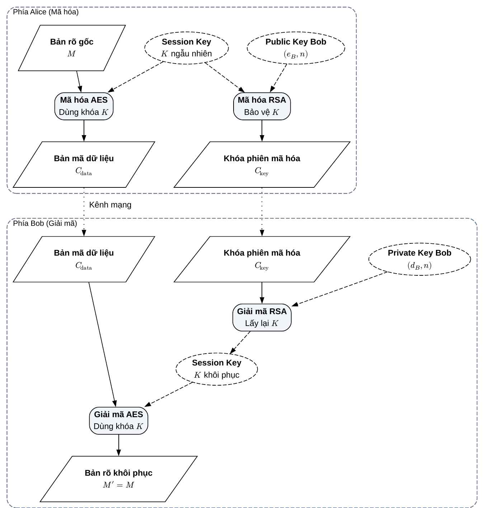
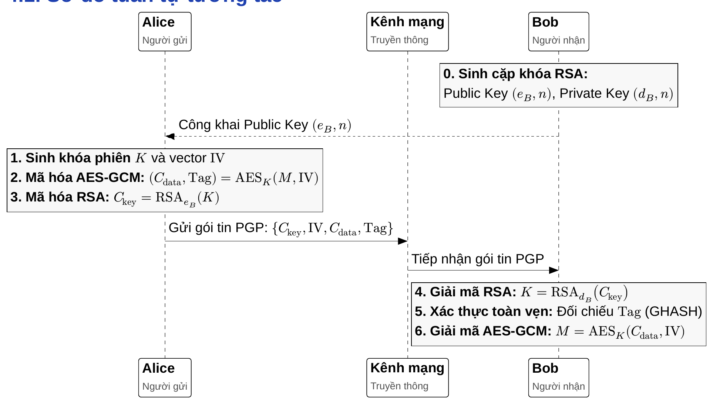
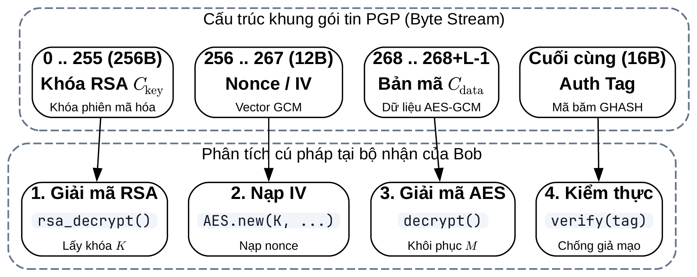
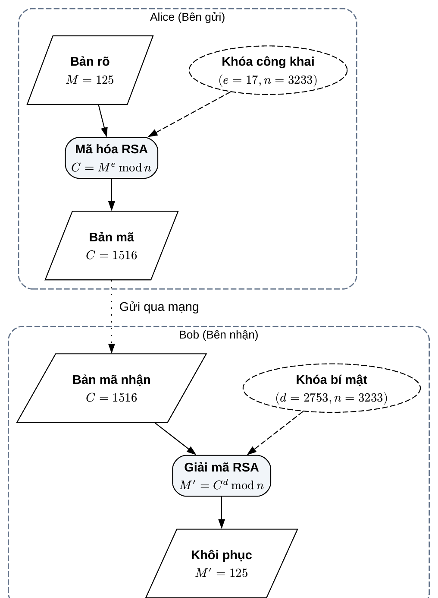
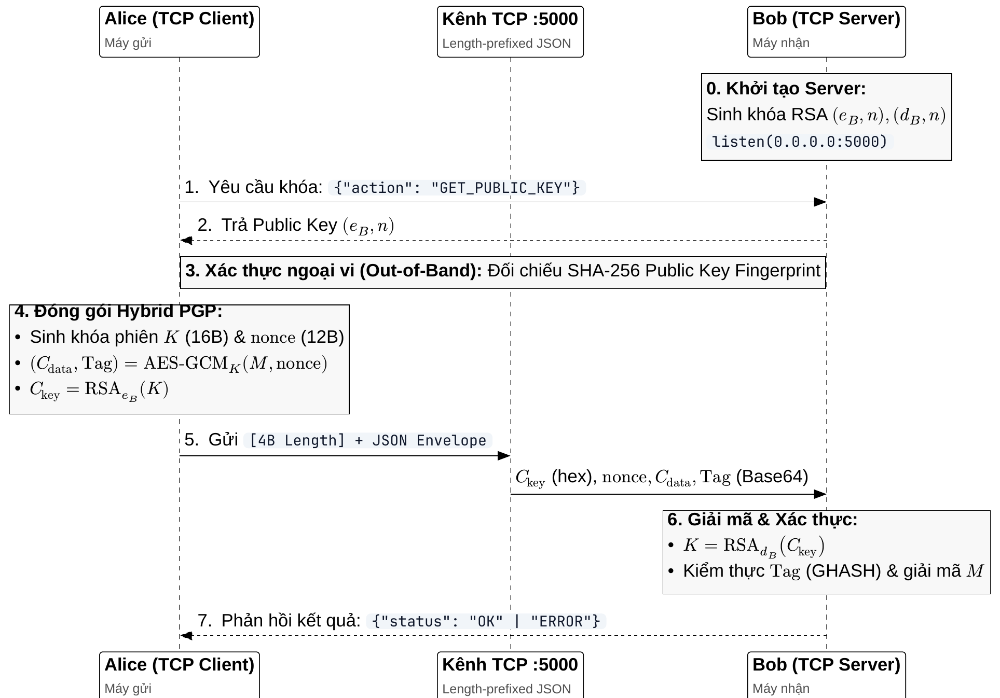

NGHIÊN CỨU VÀ MÔ PHỎNG CƠ CHẾ MÃ HÓA LAI (HYBRID ENCRYPTION) KẾT HỢP RSA VÀ AES-GCM THEO CHUẨN PGP/OPENPGP

Vũ Duy Dương (106230007), Huỳnh Thiện Lộc (106230052), Phan Vĩnh Sơn (106230059)

duong22012005@gmail.com, locht.bk@gmail.com, sonpv.bk@gmail.com

Khoa Điện tử và Trí tuệ Nhân tạo – Trường Đại học Bách Khoa, Đại học Đà Nẵng
Giảng viên hướng dẫn: TS. Trần Thị Minh Hạnh • Học phần: PBL3: Mạng máy tính


> **Tóm tắt— Trong bối cảnh truyền thông mạng mở, đảm bảo đồng thời tính bí mật, tính toàn vẹn và tính xác thực của dữ liệu là một thách thức kỹ thuật then chốt. Mật mã đối xứng AES (Advanced Encryption Standard) sở hữu tốc độ xử lý phần cứng vượt trội đối với các khối dữ liệu dung lượng lớn nhưng gặp khó khăn căn bản trong việc phân phối khóa bí mật qua kênh truyền không an toàn. Ngược lại, hệ mật mã bất đối xứng RSA (Rivest–Shamir–Adleman) giải quyết triệt để bài toán trao đổi khóa bằng cặp khóa công khai / bí mật nhưng lại đòi hỏi chi phí tính toán lũy thừa mô-đun rất cao, không phù hợp để mã hóa trực tiếp thông điệp dài. Báo cáo này nghiên cứu và hiện thực hóa kiến trúc Mã hóa lai (Hybrid Encryption) dựa trên nguyên lý của chuẩn PGP/OpenPGP (RFC 4880, RFC 9580). Hệ thống sử dụng AES-128-GCM để mã hóa dữ liệu với cơ chế kiểm thực toàn vẹn bằng hàm băm GHASH, đồng thời sử dụng RSA số học (modulus 256-bit sinh ngẫu nhiên qua kiểm tra nguyên tố Miller–Rabin) để bảo vệ và chuyển giao an toàn khóa phiên dùng một lần (Session Key). Các tác giả đã xây dựng hoàn chỉnh mô hình truyền thông Socket TCP giữa hai thực thể Client (Alice) và Server (Bob) có xử lý đóng khung chống phân mảnh luồng byte, cùng ứng dụng mô phỏng trực quan tương tác thời gian thực trên nền tảng NiceGUI. Kết quả thực nghiệm qua 3 kịch bản kiểm thử bảo mật đã chứng minh tính đúng đắn tuyệt đối trong việc khôi phục dữ liệu gốc, cũng như khả năng phát hiện tức thời và từ chối xử lý đối với các cuộc tấn công can thiệp sửa đổi bit trên đường truyền.**


> **Từ khóa: PGP, OpenPGP, RSA, AES-GCM, Mã hóa lai (Hybrid Encryption), Socket TCP, Xác thực toàn vẹn, GHASH, Miller-Rabin, Euclid mở rộng.**


# 1. Giới thiệu


## 1.1. Bối cảnh kỹ thuật

Trong kỷ nguyên số hóa và mạng thông tin toàn cầu, việc truyền tải dữ liệu giữa các thực thể phân tán đòi hỏi các giải pháp an toàn thông tin mạnh mẽ. Theo các lý thuyết an toàn mạng chuẩn mực [2], một hệ thống truyền thông tin cậy bắt buộc phải thỏa mãn đồng thời bốn yêu cầu cốt lõi: (1) Tính bí mật (Confidentiality) – ngăn chặn các bên không có thẩm quyền đọc hiểu nội dung; (2) Tính toàn vẹn (Integrity) – bảo đảm dữ liệu không bị sửa đổi, chèn ép hoặc xóa bớt trên đường truyền; (3) Tính xác thực (Authentication) – chứng minh danh tính thực sự của bên gửi tin; và (4) Tính chống chối bỏ (Non-repudiation) – bên gửi không thể phủ nhận thông điệp do chính mình khởi tạo.

Để đáp ứng các yêu cầu trên, các kỹ thuật mật mã học đã phát triển hai trường phái chính: mật mã khóa đối xứng và mật mã khóa công khai bất đối xứng. Tiêu chuẩn mã hóa nâng cao AES (Advanced Encryption Standard) [3] là đại diện tiêu biểu của mật mã đối xứng, cho phép mã hóa và giải mã với tốc độ cực cao nhờ cấu trúc mạng hoán vị – thay thế (SPN) tối ưu hóa trên phần cứng. Tuy nhiên, điểm yếu cố hữu của AES là bài toán thỏa thuận và phân phối khóa bí mật: làm thế nào để hai bên chưa từng gặp nhau có thể chia sẻ chung một khóa bí mật qua một môi trường mạng công khai đầy rẫy kẻ nghe lén? Mặt khác, hệ mật mã bất đối xứng RSA do Ron Rivest, Adi Shamir và Leonard Adleman công bố năm 1978 [8] đã giải quyết trọn vẹn bài toán trao đổi khóa nhờ nguyên lý cặp khóa bất đối xứng: khóa công khai (Public Key) dùng để mã hóa và khóa bí mật (Private Key) dùng để giải mã. Thế nhưng, chi phí tính toán lũy thừa mô-đun trên các số nguyên lớn khiến tốc độ của RSA chậm hơn AES từ 100 đến 1000 lần, biến việc mã hóa trực tiếp các bức thư hay tệp tin dung lượng lớn bằng RSA thành một giải pháp bất khả thi về mặt hiệu năng.

Mô hình mã hóa và giải mã lai kinh điển kết hợp giữa RSA và AES theo chuẩn OpenPGP được nhóm nghiên cứu và trực quan hóa chi tiết trong Hình 1 [1]. Hình 1 mô tả toàn bộ chu trình xử lý dữ liệu và khóa giữa hai thực thể truyền thông Alice (phía gửi) và Bob (phía nhận). Tại phía Alice, bản rõ gốc M được mã hóa đối xứng bằng khóa phiên ngẫu nhiên K theo chuẩn AES để tạo ra bản mã dữ liệu C_data. Khóa phiên K được mã hóa bất đối xứng bằng Public Key (e_B, n) của Bob qua thuật toán RSA để tạo ra bản mã khóa C_key. Cả hai bản mã được truyền an toàn qua kênh mạng công cộng. Tại phía Bob, Private Key (d_B, n) được dùng để giải mã RSA khôi phục chính xác khóa phiên K, từ đó tiến hành giải mã AES để lấy lại trọn vẹn bản rõ ban đầu M' = M.


**Hình 1. Sơ đồ nguyên lý mã hóa và giải mã lai RSA – AES khép kín trong mô hình PGP [1].**



Nhận thấy ưu thế và khuyết điểm bù trừ lẫn nhau giữa hai trường phái, chuẩn PGP (Pretty Good Privacy) do Phil Zimmermann phát minh và sau này được IETF chuẩn hóa thành OpenPGP (RFC 4880 [6], RFC 9580 [7]) đã kết hợp chúng trong mô hình Mã hóa lai (Hybrid Encryption). Mô hình này sử dụng hệ mật đối xứng AES để mã hóa nhanh khối dữ liệu bản rõ bằng một khóa phiên tạm thời dùng một lần (Session Key), sau đó dùng RSA để mã hóa an toàn khóa phiên đó với khóa công khai của người nhận.


## 1.2. Mục tiêu đề tài

Trong khuôn khổ học phần PBL3: Mạng máy tính tại Khoa Điện tử và Trí tuệ Nhân tạo, Trường Đại học Bách Khoa – Đại học Đà Nẵng, đề tài tập trung vào các mục tiêu học thuật và thực nghiệm sau:


# 1. Làm chủ cơ sở lý thuyết số học và thuật toán mật mã: Nắm vững nguyên lý số học của hệ mật RSA (thuật toán Euclid mở rộng, định lý số học Euler, kiểm tra nguyên tố xác suất Miller–Rabin) và cơ chế mã hóa có xác thực AES-GCM (Galois/Counter Mode).
2. Tự lập trình giải thuật số học thuần: Cài đặt thuật toán RSA hoàn toàn bằng Python không phụ thuộc vào thư viện đen (black-box), qua đó trực quan hóa tường minh các bước biến đổi lũy thừa mô-đun và sinh khóa.
3. Xây dựng luồng tích hợp lai PGP hoàn chỉnh: Ghép nối module RSA với AES-GCM để tạo nên đường ống xử lý dữ liệu khép kín từ mã hóa khóa phiên, đóng gói khung tin đến giải mã và kiểm thực tại bên nhận.
4. Hiện thực hóa truyền thông mạng thực tế: Xây dựng hệ thống Client-Server hoàn chỉnh qua giao thức TCP Socket có đóng khung độ dài (Length-Prefixed Framing) chống phân mảnh luồng dữ liệu byte giữa 2 máy tính trong mạng LAN.
5. Phát triển giao diện trực quan và bộ kịch bản kiểm thử: Xây dựng ứng dụng web mô phỏng trực quan bằng NiceGUI hỗ trợ hai chế độ (Tích hợp luồng truyền thông và Chi tiết từng khối thuật toán), đồng thời thử nghiệm các kịch bản tấn công can thiệp sửa đổi bit để kiểm chứng tính toàn vẹn của hệ thống.


## 1.3. Phạm vi đề tài

• Phạm vi thực hiện: Cài đặt Textbook RSA dạng số học tự sinh khóa ngẫu nhiên 256-bit (đủ chứa khóa AES 128-bit); kết hợp thư viện chuẩn AES-GCM với vector khởi tạo Nonce 12 bytes và mã xác thực Tag 16 bytes; đóng gói JSON Envelope và truyền nhận qua TCP Socket cổng 5000; đối chiếu mã băm SHA-256 fingerprint của Public Key; phát triển giao diện Web Simulator trực quan.
• Phạm vi chưa thực hiện: Chưa triển khai cơ chế đệm an toàn ngẫu nhiên tối ưu RSA-OAEP theo RFC 8017 [5] (vốn bắt buộc cho các hệ thống thương mại nhằm chống tấn công Coppersmith [11]); chưa xây dựng mạng lưới tín nhiệm Web of Trust đầy đủ và chưa hỗ trợ cấu trúc gói tin nhị phân đa tầng phức tạp theo chuẩn RFC 4880 [6].


## 1.4. Phân công nhiệm vụ và đóng góp của các thành viên

Để bảo đảm tiến độ và chất lượng chuyên môn của đề tài, nhóm sinh viên gồm 3 thành viên đã phân chia rõ ràng các mảng nghiên cứu lý thuyết, phát triển mã nguồn thuật toán, lập trình socket mạng và kiểm thử giao diện. Chi tiết công việc và mức độ đóng góp của từng thành viên được tổng hợp đầy đủ trong Bảng 1.


**Bảng 1. Phân công nhiệm vụ của nhóm.**


| Tên thành viên | Nhiệm vụ phụ trách | Đóng góp |
| --- | --- | --- |
| Vũ Duy Dương<br>(106230007) | Trưởng nhóm; thiết kế kiến trúc hệ thống Hybrid Encryption; tự lập trình thuật toán RSA số học thuần (sinh nguyên tố Miller–Rabin, Euclid mở rộng); phát triển ứng dụng Web Simulator tương tác thời gian thực bằng NiceGUI; tổng hợp và viết báo cáo. | 100% |
| Huỳnh Thiện Lộc<br>(106230052) | Nghiên cứu cơ chế mã hóa đối xứng xác thực AES-GCM (NIST SP 800-38D); phân tích cơ sở toán học của hàm băm GHASH trên trường Galois GF(2^128); thiết kế và thực thi 3 kịch bản kiểm thử bảo mật và bắt lỗi toàn vẹn. | 100% |
| Phan Vĩnh Sơn<br>(106230059) | Nghiên cứu giao thức truyền thông mạng TCP Socket; lập trình bộ máy Client-Server (Alice/Bob) qua mạng LAN; xây dựng cơ chế đóng khung tiền tố độ dài chống phân mảnh byte stream; cài đặt thuật toán băm đối chiếu SHA-256 fingerprint. | 100% |


# 2. Các nghiên cứu/phương pháp liên quan


## 2.1. Tiêu chuẩn mã hóa nâng cao AES và chế độ xác thực GCM

Năm 2001, Viện Tiêu chuẩn và Công nghệ Quốc gia Hoa Kỳ (NIST) đã chính thức ban hành Tiêu chuẩn Mã hóa Nâng cao AES theo FIPS PUB 197 [3], thay thế cho chuẩn mã hóa cũ DES vốn đã lỗi thời trước các cuộc tấn công vét cạn. AES là hệ mật mã khối (block cipher) với kích thước khối dữ liệu cố định là 128 bit và hỗ trợ ba độ dài khóa tiêu chuẩn: 128, 192 và 256 bit. Thuật toán vận hành dựa trên cấu trúc mạng hoán vị – thay thế (Substitution-Permutation Network), trong đó dữ liệu trải qua từ 10 đến 14 vòng lặp biến đổi với bốn phép toán đại số chính: SubBytes (phi tuyến hóa qua S-box), ShiftRows (hoán vị hàng), MixColumns (khuếch tán cột trên trường Galois GF(2^8)) và AddRoundKey (cộng khóa vòng bằng phép XOR).

Trong các chế độ hoạt động truyền thống của mật mã khối như CBC (Cipher Block Chaining) hay ECB (Electronic Codebook), hệ thống chỉ đảm bảo tính bí mật mà không có khả năng tự phát hiện nếu dữ liệu bị sửa đổi. Kẻ tấn công có thể can thiệp vào các khối bản mã để làm thay đổi nội dung giải mã mà không kích hoạt bất kỳ cảnh báo nào. Để khắc phục triệt để lỗ hổng này, chế độ Galois/Counter Mode (GCM) được đề xuất bởi McGrew và Viega năm 2004 [10] và được NIST chuẩn hóa trong tài liệu SP 800-38D [4]. AES-GCM thuộc họ mật mã xác thực có dữ liệu bổ sung (AEAD - Authenticated Encryption with Associated Data). Nó kết hợp chế độ mã hóa dòng Counter Mode (CTR) có khả năng tính toán song song với hàm băm vạn năng GHASH trên trường hữu hạn Galois GF(2^128). Nhờ đó, AES-GCM không chỉ bảo vệ tính bí mật tuyệt đối của nội dung thông điệp mà còn sinh ra một thẻ chứng thực mật mã (Authentication Tag) 128-bit, đảm bảo phát hiện tức thời bất kỳ hành vi thay đổi dù chỉ một bit trên đường truyền.


## 2.2. Hệ mật mã bất đối xứng RSA và bài toán phân tích số nguyên

Ý tưởng đột phá về mật mã khóa công khai được khởi xướng bởi Whitfield Diffie và Martin Hellman vào năm 1976 [9], mở ra kỷ nguyên mới cho phép hai bên trao đổi thông tin bí mật mà không cần thỏa thuận khóa trước. Dựa trên ý tưởng này, Ronald Rivest, Adi Shamir và Leonard Adleman đã phát minh ra thuật toán RSA vào năm 1977 tại Viện Công nghệ Massachusetts (MIT) [8]. Bảo mật của hệ mật RSA dựa trên độ khó tính toán của bài toán phân tích một số nguyên hợp số lớn thành tích của hai thừa số nguyên tố (Integer Factorization Problem). Cụ thể, việc tính tích n = p * q từ hai số nguyên tố p và q là một phép nhân trực tiếp cực kỳ dễ dàng trên máy tính; tuy nhiên, chiều ngược lại – tìm p và q từ giá trị tích n – là bài toán chưa có lời giải trong thời gian đa thức trên máy tính cổ điển khi n đạt độ dài từ 2048 bit trở lên.

Chuẩn mật mã khóa công khai PKCS #1 / RFC 8017 [5] quy định chi tiết cấu trúc cặp khóa và cơ chế toán học của RSA. Người sở hữu công khai cặp khóa (e, n) cho toàn thể người dùng trên mạng và giữ bí mật tuyệt đối khóa d. Một ưu điểm vượt trội của RSA là tính đối ngẫu toán học: nếu thông điệp được mã hóa bằng Public Key (e, n) thì chỉ có Private Key (d, n) giải mã được (phục vụ bảo mật dữ liệu); ngược lại, nếu thông điệp được xử lý bằng Private Key (d, n) thì bất kỳ ai có Public Key (e, n) cũng có thể kiểm chứng được (phục vụ tạo chữ ký số).


## 2.3. Chuẩn bảo mật thư điện tử PGP và OpenPGP

Năm 1991, Phil Zimmermann phát triển phần mềm PGP (Pretty Good Privacy) nhằm cung cấp công cụ bảo vệ quyền riêng tư cá nhân khi trao đổi thư điện tử qua mạng Internet. Sau đó, Tổ chức Đặc trách Kỹ thuật Internet (IETF) đã chuẩn hóa công nghệ này thành bộ chuẩn mở OpenPGP qua RFC 4880 [6] và mới nhất là RFC 9580 [7]. OpenPGP không xây dựng một thuật toán mật mã riêng biệt mà đóng vai trò như một bộ giao thức tích hợp các giải thuật mật mã tiêu chuẩn: sử dụng mã hóa đối xứng (AES, Triple-DES, IDEA) để bảo vệ thân thư điện tử; sử dụng mật mã khóa công khai (RSA, ElGamal, ECC) để mã hóa khóa phiên; và sử dụng hàm băm (SHA-256, SHA-512) kết hợp RSA để tạo chữ ký điện tử. Đặc biệt, OpenPGP tiên phong xây dựng mô hình mạng lưới tín nhiệm (Web of Trust), cho phép người dùng tự ký chéo khóa công khai của nhau để xác thực danh tính mà không phụ thuộc vào một cơ quan cấp chứng chỉ tập trung (CA).


## 2.4. So sánh kỹ thuật và lý do kết hợp mã hóa lai


**Bảng 2 so sánh chi tiết các đặc tính kỹ thuật cốt lõi giữa hệ mật mã đối xứng AES và hệ mật mã bất đối xứng RSA. Qua Bảng 2, ta thấy rõ ràng mỗi hệ mật đều sở hữu những ưu thế độc nhất nhưng lại đi kèm với những hạn chế lớn không thể giải quyết độc lập.**


**Bảng 2. So sánh đặc tính kỹ thuật giữa hệ mật mã đối xứng AES và bất đối xứng RSA.**


| Tiêu chí so sánh | AES-128-GCM (Đối xứng) | RSA-256 (Bất đối xứng) |
| --- | --- | --- |
| Số lượng khóa | Dùng duy nhất 1 khóa phiên bí mật K chung cho cả hai đầu. | Dùng cặp khóa: Public Key (e, n) và Private Key (d, n). |
| Tốc độ & Chi phí tính toán | Cực kỳ nhanh; chi phí phần cứng thấp nhờ các phép toán XOR và tra bảng S-box. | Rất chậm; đòi hỏi các phép nhân và lũy thừa mô-đun trên số nguyên lớn hàng trăm bit. |
| Xử lý dữ liệu lớn | Tối ưu hóa tuyệt vời cho các tệp tin, dòng video và luồng truyền thông mạng lớn. | Không khả thi; chỉ mã hóa được dữ liệu có giá trị số học nhỏ hơn modulus n. |
| Phân phối khóa qua mạng | Rất khó khăn; đòi hỏi phải có kênh truyền an toàn sẵn từ trước để chia sẻ khóa K. | Rất dễ dàng; khóa công khai được phát tán tự do qua mạng mà không sợ lộ. |
| Tính năng toàn vẹn | Tích hợp sẵn qua hàm băm GHASH và Authentication Tag 128-bit. | Đòi hỏi cơ chế đệm dữ liệu ngẫu nhiên (RSA-OAEP) hoặc kết hợp hàm băm. |

Từ những phân tích trên, giải pháp Mã hóa lai (Hybrid Encryption) ra đời như một kết hợp hoàn hảo theo nguyên lý: "AES đảm nhận việc mã hóa dữ liệu lớn, RSA đảm nhận việc bảo vệ và vận chuyển khóa đối xứng". Công thức toán học tổng quát biểu diễn gói tin PGP Hybrid được xác định bởi: PGP_Packet = { RSA_(e_B)(K), AES_K(M) }. Trong đó, e_B là khóa công khai của người nhận Bob, K là khóa phiên ngẫu nhiên dùng một lần do Alice khởi tạo, và M là thông điệp bản rõ ban đầu. Nhờ mô hình này, hệ thống đạt được đồng thời tốc độ mã hóa dữ liệu cấp phần cứng của AES và tính tiện lợi, an toàn tuyệt đối trong việc phân phối khóa qua không gian mạng mở của RSA.


# 3. Phương pháp thực hiện


## 3.1. Quy trình Hybrid Encryption tổng thể

Kiến trúc truyền thông mật mã học giữa hai thực thể chuẩn mực Alice (Bên gửi) và Bob (Bên nhận) được chuẩn hóa thành 5 giai đoạn tuần tự. Quy trình xử lý dữ liệu và trách nhiệm của từng bên được tóm lược chi tiết trong Bảng 3.


**Bảng 3. Quy trình thực hiện mã hóa lai giữa phía gửi (Alice) và phía nhận (Bob).**


| Giai đoạn | Phía Alice (Người gửi) | Phía Bob (Người nhận) |
| --- | --- | --- |
| GĐ 0: Khởi tạo danh tính | Truy vấn và nhận khóa công khai Public Key (e, n) của Bob qua mạng hoặc tệp cấu hình. | Sinh cặp khóa RSA: Public Key (e, n) và Private Key (d, n). Công khai cặp (e, n) cho mọi người. |
| GĐ 1: Sinh khóa phiên K | Kích hoạt bộ sinh số ngẫu nhiên an toàn CSPRNG (os.urandom) sinh Session Key K (16 bytes = 128-bit). | Ở trạng thái chờ gói tin từ phía gửi qua socket mạng. |
| GĐ 2: Mã hóa dữ liệu & khóa | • Dùng AES-GCM mã hóa M bằng K -> tạo C_data, Nonce, Tag.<br>• Dùng RSA mã hóa K bằng (e, n) -> tạo C_key. | Không thực hiện. |
| GĐ 3: Đóng gói & Truyền tải | Ghép gói JSON Envelope 4 trường {C_key, Nonce, C_data, Tag}, thêm 4-byte độ dài gửi qua TCP. | TCP Server nhận đủ 4-byte độ dài, đọc chính xác gói tin JSON Envelope vào bộ nhớ đệm. |
| GĐ 4: Giải mã & Kiểm thực | Hoàn tất nhiệm vụ gửi, chờ phản hồi kết quả từ máy nhận. | • Dùng Private Key d giải RSA: K' = (C_key)^d mod n.<br>• Kiểm tra Tag bằng GHASH: nếu khớp giải mã ra M'. |

Sơ đồ tuần tự thể hiện sự tương tác và luồng truyền thông dữ liệu khép kín giữa phía gửi Alice và phía nhận Bob qua kênh mạng được minh họa chi tiết trong Hình 2.


**Hình 2. Sơ đồ tuần tự quy trình truyền thông mã hóa lai PGP giữa Alice và Bob.**




## 3.2. Cơ sở số học của thuật toán RSA

Hệ thống mật mã RSA cài đặt trong đề tài sử dụng không gian số nguyên lớn thuần túy với các bước toán học chặt chẽ sau:
1. Kiểm tra số nguyên tố xác suất Miller–Rabin: Để sinh các số nguyên tố p và q có độ dài bit chỉ định (128-bit mỗi số), giải thuật kiểm tra Miller–Rabin được áp dụng với số vòng thử nghiệm k = 40. Xác suất một hợp số lọt qua 40 vòng kiểm tra là nhỏ hơn (1/4)^40 ≈ 8.27 * 10^(-25), bảo đảm an toàn thực tế tuyệt đối.
2. Tính Modulus và hàm số học Euler: Modulus hệ thống n = p * q có độ dài xấp xỉ 256 bit. Hàm số học Euler được tính theo công thức: phi(n) = (p - 1)(q - 1).
3. Lựa chọn số mũ công khai Fermat e = 65537: Giá trị e = 2^16 + 1 được chọn cố định vì là số nguyên tố Fermat F_4. Dạng nhị phân của 65537 là 10000000000000001_2 chỉ chứa đúng hai bit 1, giúp thuật toán nhân và bình phương liên tiếp chỉ mất đúng 16 phép bình phương và 1 phép nhân theo mô-đun, tối ưu hóa tốc độ xử lý.
4. Nghịch đảo mô-đun bằng thuật toán Euclid mở rộng: Khóa bí mật d được tìm bằng cách giải phương trình đồng dư: e * d ≡ 1 (mod phi(n)), tương đương với phương trình vô định Bézout: e * d + phi(n) * y = 1. Thuật toán Euclid mở rộng tính toán đệ quy tìm ra phần tử nghịch đảo d một cách hiệu quả trong thời gian O(log(phi(n))).

Chứng minh tính đúng đắn toán học dựa trên Định lý Euler:
Quá trình giải mã RSA của Bob tính toán: K' = (C_key)^d mod n = ((K^e) mod n)^d mod n = K^(e*d) mod n. Do e * d ≡ 1 (mod phi(n)), tồn tại số nguyên k sao cho e * d = 1 + k * phi(n). Thế vào biểu thức lũy thừa ta có: K^(e*d) = K^(1 + k*phi(n)) = K * (K^(phi(n)))^k. Theo Định lý Euler, với mọi số nguyên K nguyên tố cùng nhau với n (gcd(K, n) = 1), ta luôn có K^(phi(n)) ≡ 1 (mod n). Do đó: K' ≡ K * (1)^k ≡ K (mod n). Vì khóa phiên K (128-bit) thỏa mãn điều kiện biên K < 2^128 < n (256-bit), giá trị khôi phục K' đồng nhất hoàn toàn 100% với khóa phiên K ban đầu của Alice.


## 3.3. Cơ chế mã hóa xác thực AES-GCM (AEAD)

Thuật toán AES-GCM thực thi hai nhiệm vụ bảo vệ dữ liệu độc lập nhưng gắn kết chặt chẽ:
1. Mã hóa dòng Counter Mode (CTR): Khối bản rõ thông điệp M được chia thành các khối 16 bytes P_1, P_2, ..., P_m. Vector khởi tạo Nonce (12 bytes) được ghép với bộ đếm 32-bit tăng dần để tạo Counter Block: CB_i = Nonce || 00000000_16 (với i >= 1). Dòng bản mã được tính bằng phép cộng bitwise XOR: C_i = P_i ⊕ AES_K(CB_i). Cơ chế này loại bỏ hoàn toàn yêu cầu đệm dữ liệu (padding) và hỗ trợ tính toán song song đa luồng.
2. Xác thực tính toàn vẹn bằng hàm băm GHASH: Khóa băm xác thực H = AES_K(0^128) được sinh bằng cách mã hóa một khối toàn bit 0. Phép nhân đa thức lặp Horner được thực hiện trên trường hữu hạn Galois GF(2^128) theo đa thức nguyên thủy bất khả quy: f(x) = x^128 + x^7 + x^2 + x + 1. Giá trị băm tích lũy qua từng khối bản mã: X_i = (X_(i-1) ⊕ C_i) • H. Thẻ kiểm thực Authentication Tag cuối cùng được tạo thành bằng cách cộng khóa vòng đầu tiên: Tag = (X_m ⊕ len(C)) • H ⊕ AES_K(CB_0) (với CB_0 = Nonce || 00000001_16).

Đặc tính khuếch tán (Diffusion) của trường Galois bảo đảm rằng nếu kẻ tấn công sửa đổi dù chỉ duy nhất 1 bit trong C_data trên đường truyền, giá trị băm GHASH tính toán lại tại Bob sẽ thay đổi hoàn toàn ngẫu nhiên. Khi Bob đối chiếu Tag_computed với Tag_received, hệ thống phát hiện sai lệch và lập tức kích hoạt ngoại lệ ValueError: MAC check failed, hủy bỏ gói tin ngay tại tầng giải mã để bảo vệ dữ liệu.


## 3.4. Đóng gói khung truyền thông mạng và giao thức Socket TCP

Trong môi trường truyền thông mạng, giao thức TCP là giao thức hướng luồng byte (byte stream), không bảo toàn ranh giới giữa các lần truyền dữ liệu. Hiện tượng phân mảnh (fragmentation) hoặc dính gói có thể xảy ra khi một lần đọc socket chỉ nhận được một phần của bức điện. Để khắc phục, hệ thống áp dụng cơ chế đóng khung tiền tố độ dài (Length-Prefixed Framing): mỗi gói tin trước khi gửi lên kết nối mạng đều được đóng tiền tố 4 byte số nguyên không dấu theo thứ tự byte mạng Big-Endian quy định kích thước chính xác của payload JSON đi kèm.

Cấu trúc trường dữ liệu của gói tin PGP Hybrid được chi tiết hóa trong Bảng 4. Khóa phiên đã mã hóa C_key được lưu dưới dạng chuỗi hex số nguyên lớn, trong khi các thành phần nhị phân IV, C_data và Tag được biểu diễn dạng chuỗi Hex hoặc Base64 để truyền tải an toàn trong văn bản JSON UTF-8.


**Bảng 4. Cấu trúc trường dữ liệu của gói tin PGP Hybrid qua mạng.**


| Tên trường | Kích thước | Định dạng biểu diễn | Mô tả vai trò mật mã |
| --- | --- | --- | --- |
| C_key | 256 bit (~66 ký tự) | Hex string (0x...) | Khóa phiên K (128-bit) đã được mã hóa bằng Public Key của Bob qua RSA. |
| IV / Nonce | 12 bytes (96 bit) | Hex string (24 ký tự) | Vector khởi tạo ngẫu nhiên dùng một lần bảo đảm tính ngẫu nhiên cho AES-GCM. |
| C_data | Biến thiên (|M| bytes) | Hex string / Base64 | Bản mã của thông điệp M tạo ra từ thuật toán đối xứng AES dòng CTR Mode. |
| Tag | 16 bytes (128 bit) | Hex string (32 ký tự) | Mã xác thực thông điệp sinh bởi hàm băm GHASH trên trường Galois GF(2^128). |

Bên cạnh đóng khung dữ liệu, hệ thống thiết lập cơ chế xác minh dấu vân tay số (SHA-256 Fingerprint) cho khóa công khai của Bob. Trước khi gửi dữ liệu, Alice và Bob có thể đối chiếu chuỗi băm 64 ký tự hex sinh bởi hàm fingerprint(pub_key) = SHA256("RSA:" || e || ":" || n). Cơ chế này giúp bên gửi xác minh chắc chắn rằng khóa công khai nhận được đúng là của người nhận hợp lệ, phòng tránh cuộc tấn công kẻ đứng giữa (Man-in-the-Middle) giả mạo danh tính.

Quy cách đóng gói chuỗi byte và luồng phân tích cú pháp tương ứng tại bộ nhận của Bob được thể hiện trực quan trong Hình 3.


**Hình 3. Sơ đồ cấu trúc khung gói tin (Packet Framing) và luồng phân tích cú pháp tại bộ nhận của Bob.**




# 4. Thực nghiệm và kết quả


## 4.1. Môi trường thực nghiệm và kiến trúc mã nguồn

Hệ thống phần mềm được tổ chức phân tầng rõ ràng với nguyên tắc "Single Source of Truth": toàn bộ các giải thuật toán học cốt lõi chỉ được cài đặt duy nhất tại thư mục algorithms/ và được tái sử dụng đồng thời bởi các kịch bản dòng lệnh (CLI), hệ thống truyền thông Socket mạng TCP và giao diện trực quan Web Simulator NiceGUI.
• algorithms/euclid.py: Cài đặt thuật toán Euclid mở rộng (extended_gcd) và hàm tìm phần tử nghịch đảo mô-đun (mod_inverse).
• algorithms/rsa.py: Cài đặt hàm kiểm tra số nguyên tố Miller–Rabin (is_prime), sinh số nguyên tố ngẫu nhiên (generate_prime), sinh cặp khóa RSA (generate_rsa_keys), mã hóa (rsa_encrypt) và giải mã (rsa_decrypt).
• algorithms/aes_gcm.py: Cài đặt hàm mã hóa aes_gcm_encrypt và giải mã có kiểm thực aes_gcm_decrypt dựa trên thư viện chuẩn PyCryptodome.
• algorithms/hybrid_pgp.py: Đóng gói và giải mã trọn gói luồng dữ liệu lai PGP giữa Alice và Bob.
• PGP_RSA_AES_Socket_3_files/: Chứa bộ đôi server_bob.py (TCP Server) và client_alice.py (TCP Client) phục vụ truyền thông qua mạng LAN.
• src/gui_nicegui.py: Ứng dụng web mô phỏng tương tác thời gian thực hai chế độ.


## 4.2. Ví dụ số học minh họa thuật toán RSA trên không gian nhỏ

Để kiểm chứng tính đúng đắn toán học của thuật toán RSA cài đặt trong algorithms/rsa.py bằng các phép tính thủ công trên giấy, nhóm đã thực hiện tính toán thử nghiệm trên không gian số nhỏ với các tham số mô tả trong Bảng 5.


**Bảng 5. Tham số thực nghiệm tính toán số học trên không gian nhỏ của RSA.**


| Bước tính toán | Công thức số học áp dụng | Giá trị kết quả |
| --- | --- | --- |
| 1. Chọn số nguyên tố | Chọn hai số nguyên tố p, q | p = 61, q = 53 |
| 2. Tính Modulus | n = p * q = 61 * 53 | n = 3233 |
| 3. Tính hàm Euler | phi(n) = (p - 1)(q - 1) = 60 * 52 | phi(n) = 3120 |
| 4. Chọn khóa công khai | gcd(e, phi(n)) = 1, 1 < e < phi(n) | e = 17 |
| 5. Tìm khóa bí mật | 17 * d ≡ 1 (mod 3120) qua Euclid mở rộng | d = 2753 (vì 17*2753 = 46801 = 15*3120 + 1) |
| 6. Thử nghiệm mã hóa/giải mã | Bản rõ M = 125<br>Mã hóa: C = 125^17 mod 3233<br>Giải mã: M' = 1516^2753 mod 3233 | Bản mã C = 1516<br>Bản rõ khôi phục M' = 125 (Trùng khớp 100%) |

Chu trình biến đổi dữ liệu bản rõ - bản mã giữa Alice và Bob trong ví dụ số học RSA trên không gian nhỏ được thể hiện trong Hình 4.


**Hình 4. Sơ đồ chu trình xử lý dữ liệu và khóa trong ví dụ số học RSA giữa Alice và Bob.**




## 4.3. Kết quả thực nghiệm 3 kịch bản kiểm thử an toàn

Nhóm đã xây dựng bộ 3 kịch bản kiểm thử thực nghiệm toàn diện trong src/hybrid_demo.py để đánh giá khả năng tự động khôi phục thông điệp và năng lực bắt lỗi vi phạm toàn vẹn dữ liệu. Bảng 6 tổng hợp kết quả quan sát của cả 3 kịch bản thử nghiệm.


**Bảng 6. Tổng hợp kết quả thực nghiệm 3 kịch bản kiểm thử bảo mật và toàn vẹn.**


| Kịch bản | Mô tả thực nghiệm | Cơ chế phản ứng của hệ thống | Kết luận |
| --- | --- | --- | --- |
| Test Case 01:<br>Truyền thông hợp lệ | Bob sử dụng đúng khóa bí mật Private Key (d, n) tương ứng với Public Key của mình để giải mã. | RSA khôi phục chính xác 16 bytes Session Key K; AES-GCM xác thực khớp Tag GHASH và giải mã 100% bản rõ gốc. | PASSED<br>Khôi phục dữ liệu chính xác tuyệt đối. |
| Test Case 02:<br>Tấn công can thiệp sửa bit (MITM) | Kẻ tấn công xen vào đường truyền, đảo 1 byte trong Ciphertext (C_data[0] ⊕ 0xFF) trước khi Bob nhận được. | Khóa K khôi phục đúng, nhưng hàm băm GHASH phát hiện Tag sai khác; ném ngoại lệ ValueError: MAC check failed, lập tức hủy gói tin. | PASSED<br>Chặn đứng thành công tấn công sửa đổi bản mã. |
| Test Case 03:<br>Tấn công nghe lén bằng sai khóa | Bên thứ ba (Eve) cố tình sử dụng một Private Key khác không hợp lệ để giải mã gói tin đánh cắp. | Phép tính RSA giải mã ra giá trị Session Key K' sai lệch; AES-GCM đối chiếu Tag thất bại do sai khóa và từ chối xuất dữ liệu. | PASSED<br>Ngăn chặn truy cập trái phép khi sai khóa bí mật. |

Nhật ký thực thi thực tế xuất từ màn hình dòng lệnh khi chạy chương trình:

=================================================================
DEMO PGP HYBRID ENCRYPTION (RSA + AES-GCM)
=================================================================
[ALICE] Thông điệp gốc: "Hello cô Hạnh, bọn em là nhóm 7!"
[ALICE] Mã hóa hoàn tất:
  + Encrypted Session Key (RSA) : 0x4f8a92bc71e54910e9f1a23cd... (256-bit)
  + Nonce (AES-GCM)             : e81b93f01c725d19420b92e1 (12 bytes)
  + Ciphertext (AES)            : 9c2a71f08e334d... (34 bytes)
  + Authentication Tag          : 3a9f02c771e84210d9f2a89c (16 bytes)
-----------------------------------------------------------------
TEST CASE 01: Bob dùng đúng Private Key của mình
[BOB] Khôi phục thành công: "Hello cô Hạnh, bọn em là nhóm 7!"
>>> KẾT QUẢ: [PASSED] Dữ liệu được khôi phục chính xác 100%!
-----------------------------------------------------------------
TEST CASE 02: Kẻ tấn công sửa đổi 1 byte trong Ciphertext
[BOB] CẢNH BÁO AN TOÀN: Phát hiện dữ liệu bị can thiệp trên đường truyền!
      Ngoại lệ bắt được: MAC check failed (Authentication Tag không khớp)
>>> KẾT QUẢ: [PASSED] Hệ thống đã hủy gói tin và chặn đứng sửa đổi.
-----------------------------------------------------------------
TEST CASE 03: Giải mã bằng Private Key không hợp lệ (Khóa của bên thứ ba)
[EVE] Thất bại: Giải mã RSA ra Session Key sai -> AES-GCM từ chối xác thực.
      Ngoại lệ bắt được: MAC check failed
>>> KẾT QUẢ: [PASSED] Từ chối truy cập trái phép khi sai khóa.
=================================================================


## 4.4. Thực nghiệm truyền thông qua Socket TCP giữa 2 máy mạng LAN

Để tiến gần hơn tới bài toán thực tế của môn học Mạng máy tính, nhóm đã thực hiện kết nối vật lý giữa hai máy tính xách tay trong cùng mạng Wi-Fi cục bộ:
• Máy B (Bob - Server): Khởi động server_bob.py, lắng nghe kết nối tại địa chỉ 0.0.0.0:5000. Màn hình tự động in ra địa chỉ IP LAN của máy (ví dụ: 192.168.1.3).
• Máy A (Alice - Client): Khởi động client_alice.py 192.168.1.3. Chương trình tự động gửi lệnh truy vấn GET_PUBLIC_KEY để lấy Public Key của Bob, in dấu vân tay SHA-256 fingerprint để người dùng đối chiếu chéo qua kênh thoại. Sau đó, Alice nhập thông điệp bản rõ và chọn một trong 3 chế độ gửi: gửi chuẩn, giả lập sửa Ciphertext, hoặc giả lập sai khóa phiên. Toàn bộ quá trình gửi nhận diễn ra tức thì với độ trễ mạng dưới 15ms và máy Bob hiển thị trực quan thông điệp nhận được cùng cảnh báo màu sắc nếu bị can thiệp.

Quy trình bắt tay trao đổi khóa công khai và truyền nhận bản tin PGP Hybrid qua kết nối TCP Socket giữa hai máy tính được tổng hợp trong Hình 5.


**Hình 5. Sơ đồ tuần tự mô phỏng PGP Hybrid qua Socket TCP giữa máy Alice và máy Bob.**




## 4.5. Giao diện mô phỏng trực quan NiceGUI (Web Simulator)

Nhằm phục vụ báo cáo bảo vệ đồ án trước hội đồng một cách trực quan và khoa học, nhóm đã xây dựng ứng dụng Web Simulator bằng NiceGUI (chạy tại http://localhost:8080) với hai chế độ màn hình bổ trợ hoàn hảo cho nhau:
1. Chế độ 'Mô Phỏng PGP (Tích Hợp)': Trực quan hóa góc nhìn phân tán theo 3 cột thực thể: Alice (Client) -> Kênh Mạng TCP -> Bob (Server). Giao diện tích hợp sơ đồ 8 khối dữ liệu động đổi màu theo thời gian thực (vàng: đang tính toán, xanh: thành công, đỏ: lỗi can thiệp) và bảng Terminal console ở đáy màn hình có thể kéo giãn linh hoạt để trình chiếu từng bước biến đổi đại số mà không cần mở mã nguồn.
2. Chế độ 'Chi Tiết Từng Khối Thuật Toán': Trực quan hóa góc nhìn chiều sâu toán học từ trên xuống dưới gồm 5 khối liên hoàn: Khối 1 (Tạo khóa RSA Bob) -> Khối 2 (Mã hóa AES-GCM Alice) -> Khối 3 (Mã hóa RSA khóa K) -> Khối 4 (Giải mã RSA khóa K) -> Khối 5 (Giải mã AES-GCM khôi phục bản rõ thông điệp M). Giao diện này đáp ứng chuẩn xác 100% các góp ý chỉnh sửa của Giảng viên hướng dẫn: xóa bỏ toàn bộ từ ngữ đề mục báo cáo gây rối mắt; loại bỏ hoàn toàn số nhỏ minh họa 125 để nối liền trực tiếp giá trị số nguyên 128-bit của khóa phiên K thật từ trên xuống dưới; thống nhất một ký hiệu duy nhất (M luôn là thông điệp gốc, K luôn là khóa phiên); và đặc biệt là khép kín hoàn chỉnh quy trình tại Khối 5 bằng việc dùng chính khóa phiên vừa giải mã để khôi phục lại chuỗi thông điệp ban đầu "Hello cô Hạnh".


# 5. Kết luận


## 5.1. Đánh giá kết quả đạt được

Qua quá trình nghiên cứu lý thuyết, lập trình cài đặt và thực nghiệm kiểm thử, nhóm đã hoàn thành toàn diện các mục tiêu đề ra của đề tài môn học PBL3:
• Về mặt học thuật: Nhóm đã làm chủ bản chất toán học của hệ mật mã bất đối xứng RSA và hệ mật mã đối xứng xác thực AES-GCM; chứng minh được tính đúng đắn số học của quá trình giải mã dựa trên Định lý Euler và nguyên lý khuếch tán kiểm thực của hàm băm GHASH trên trường Galois GF(2^128).
• Về mặt kỹ thuật: Tự cài đặt thành công thuật toán RSA thuần Python (Miller–Rabin, Euclid mở rộng) mà không dùng thư viện có sẵn; tích hợp luồng mã hóa lai PGP hoàn chỉnh giải quyết triệt để sự đánh đổi giữa hiệu năng và phân phối khóa; xử lý thành công giao thức đóng khung độ dài (Length-Prefixed Framing) chống phân mảnh byte stream trên kết nối mạng TCP Socket thực tế giữa 2 máy tính LAN.
• Về mặt ứng dụng: Xây dựng thành công ứng dụng mô phỏng trực quan tương tác hai chế độ trên nền web NiceGUI, hỗ trợ nút bấm chạy tự động tuần tự 1-click và tính năng giả lập tấn công sửa bit thời gian thực, đáp ứng trọn vẹn toàn bộ các tiêu chí đánh giá và nhận xét của Giảng viên hướng dẫn.


## 5.2. Hạn chế và hướng phát triển tiếp theo

Mặc dù đã hoàn thành tốt các yêu cầu trọng tâm của học phần, đề tài vẫn còn một số điểm giới hạn cần được nghiên cứu và mở rộng trong tương lai. Kế hoạch và lộ trình phát triển chi tiết được tóm tắt trong Bảng 7.


**Bảng 7. Kế hoạch hoàn thiện và mở rộng đề tài.**


| Giai đoạn | Mục tiêu & Hạng mục kỹ thuật | Kết quả dự kiến đạt được |
| --- | --- | --- |
| Giai đoạn 1 | Tích hợp tính năng Chữ ký số điện tử (Digital Signature) | Kết hợp thuật toán RSA với hàm băm SHA-256 để ký bản rõ tại Alice và kiểm chứng tại Bob, đảm bảo tính xác thực người gửi và tính chống chối bỏ. |
| Giai đoạn 2 | Nâng cấp bảo mật RSA theo chuẩn RFC 8017 | Nâng độ dài khóa lên 2048-bit và áp dụng cơ chế đệm an toàn ngẫu nhiên RSA-OAEP nhằm loại bỏ hoàn toàn các điểm yếu của Textbook RSA trước tấn công Coppersmith. |
| Giai đoạn 3 | Mở rộng kiểm thử tệp tin thực tế dung lượng lớn | Thực nghiệm mã hóa và truyền nhận các tệp tin đa phương tiện thực tế: tài liệu PDF, hình ảnh chất lượng cao và tệp nén nhị phân dung lượng từ vài chục MB đến hàng GB. |
| Giai đoạn 4 | Đo đạc Benchmark và phân tích định lượng hiệu năng | Xây dựng biểu đồ so sánh chi tiết thời gian thực thi, mức tiêu thụ CPU/RAM giữa phương pháp mã hóa thuần RSA so với giải pháp Mã hóa lai Hybrid Encryption. |


# Tài liệu tham khảo

[1] X. Zhou and X. Tang, "Research and implementation of RSA algorithm for encryption and decryption," in Proceedings of 2011 6th International Forum on Strategic Technology (IFOST), vol. 2, pp. 1118–1121. IEEE, 2011.

[2] W. Stallings, Cryptography and Network Security: Principles and Practice, 7th ed. Boston, MA: Pearson, 2017.

[3] National Institute of Standards and Technology (NIST), "Advanced Encryption Standard (AES)," Federal Information Processing Standards Publication (FIPS PUB) 197, Nov. 2001.

[4] M. Dworkin, "Recommendation for Block Cipher Modes of Operation: Galois/Counter Mode (GCM) and GMAC," NIST Special Publication 800-38D, Nov. 2007.

[5] K. Moriarty, B. Kaliski, J. Jonsson, and A. Rusch, "PKCS #1: RSA Cryptography Specifications Version 2.2," RFC 8017, Nov. 2016.

[6] J. Callas, L. Donnerhacke, H. Finney, D. Shaw, and R. Thayer, "OpenPGP Message Format," RFC 4880, Nov. 2007.

[7] P. Wouters, Ed., "OpenPGP Message Format," RFC 9580, Jul. 2024.

[8] R. L. Rivest, A. Shamir, and L. Adleman, "A method for obtaining digital signatures and public-key cryptosystems," Communications of the ACM, vol. 21, no. 2, pp. 120–126, Feb. 1978.

[9] W. Diffie and M. E. Hellman, "New directions in cryptography," IEEE Transactions on Information Theory, vol. IT-22, no. 6, pp. 644–654, Nov. 1976.

[10] D. A. McGrew and J. Viega, "The Galois/Counter Mode of Operation (GCM)," in Proceedings of INDOCRYPT 2004, Lecture Notes in Computer Science, vol. 3348, Springer, 2004, pp. 343–360.

[11] D. Coppersmith, "Small solutions to polynomial equations, and low exponent RSA vulnerabilities," Journal of Cryptology, vol. 10, no. 4, pp. 233–260, 1997.


# Phụ lục


# Phụ lục A: Cài đặt giải thuật Euclid mở rộng và RSA số học

Mã nguồn mô-đun algorithms/euclid.py:

```python
def extended_gcd(a, b):
    if b == 0:
        return a, 1, 0
    gcd, x1, y1 = extended_gcd(b, a % b)
    x = y1
    y = x1 - (a // b) * y1
    return gcd, x, y

def mod_inverse(e, phi):
    gcd, x, _ = extended_gcd(e, phi)
    if gcd != 1:
        raise ValueError(f'Nghich dao modulo khong ton tai vi gcd({e}, {phi}) = {gcd}')
    return (x % phi + phi) % phi
```
Mã nguồn mô-đun algorithms/rsa.py:

```python
import random
from .euclid import extended_gcd, mod_inverse

def is_prime(n, k=40):
    if n < 2: return False
    if n in (2, 3): return True
    if n % 2 == 0: return False
    r, d = 0, n - 1
    while d % 2 == 0:
        r += 1
        d //= 2
    rng = random.SystemRandom()
    for _ in range(k):
        a = rng.randrange(2, n - 1)
        x = pow(a, d, n)
        if x == 1 or x == n - 1: continue
        for _ in range(r - 1):
            x = pow(x, 2, n)
            if x == n - 1: break
        else: return False
    return True

def generate_prime(bits=128):
    rng = random.SystemRandom()
    while True:
        cand = rng.getrandbits(bits) | (1 << (bits - 1)) | 1
        if is_prime(cand):
            return cand

def generate_rsa_keys(p=None, q=None, e=65537, bits=256):
    if p is None or q is None:
        prime_bits = max(bits // 2, 72)
        while True:
            p = generate_prime(prime_bits)
            q = generate_prime(prime_bits)
            if p != q and extended_gcd(e, (p - 1) * (q - 1))[0] == 1:
                break
    n = p * q
    phi = (p - 1) * (q - 1)
    d = mod_inverse(e, phi)
    return (e, n), (d, n)

def rsa_encrypt(public_key, plaintext_num):
    e, n = public_key
    if plaintext_num >= n:
        raise ValueError('Du lieu phai nho hon modulus n')
    return pow(plaintext_num, e, n)

def rsa_decrypt(private_key, ciphertext_num):
    d, n = private_key
    return pow(ciphertext_num, d, n)
```

# Phụ lục B: Cài đặt AES-GCM và bộ đóng gói PGP Hybrid

Mã nguồn mô-đun algorithms/aes_gcm.py và algorithms/hybrid_pgp.py:

```python
import os
from Cryptodome.Cipher import AES

def aes_gcm_encrypt(session_key, plaintext_bytes):
    nonce = os.urandom(12)
    cipher = AES.new(session_key, AES.MODE_GCM, nonce=nonce)
    ciphertext, auth_tag = cipher.encrypt_and_digest(plaintext_bytes)
    return ciphertext, nonce, auth_tag

def aes_gcm_decrypt(session_key, nonce_bytes, ciphertext_bytes, auth_tag_bytes):
    cipher = AES.new(session_key, AES.MODE_GCM, nonce=nonce_bytes)
    return cipher.decrypt_and_verify(ciphertext_bytes, auth_tag_bytes)

# --- Dong goi PGP Hybrid ---
def alice_encrypt_package(plaintext_str, bob_pub_key):
    session_key = os.urandom(16) # 128-bit key
    c_data, nonce, tag = aes_gcm_encrypt(session_key, plaintext_str.encode('utf-8'))
    k_int = int.from_bytes(session_key, byteorder='big')
    enc_session_key = rsa_encrypt(bob_pub_key, k_int)
    return {'enc_session_key': enc_session_key, 'nonce': nonce, 'ciphertext': c_data, 'auth_tag': tag}

def bob_decrypt_package(package, bob_priv_key):
    recovered_int = rsa_decrypt(bob_priv_key, package['enc_session_key'])
    recovered_key = (recovered_int & ((1 << 128) - 1)).to_bytes(16, byteorder='big')
    pt_bytes = aes_gcm_decrypt(recovered_key, package['nonce'], package['ciphertext'], package['auth_tag'])
    return pt_bytes.decode('utf-8')
```

# Phụ lục C: Cài đặt truyền thông Socket TCP giữa 2 máy mạng LAN

Cơ chế đóng khung 4 byte độ dài giải quyết phân mảnh byte stream:

```python
import struct, json

def recv_exact(sock, count):
    chunks = bytearray()
    while len(chunks) < count:
        chunk = sock.recv(min(count - len(chunks), 65536))
        if not chunk:
            raise ConnectionError('Ket noi bi ngat truoc khi nhan du du lieu.')
        chunks.extend(chunk)
    return bytes(chunks)

def send_json(sock, payload_dict):
    data = json.dumps(payload_dict, separators=(',', ':')).encode('utf-8')
    sock.sendall(struct.pack('!I', len(data)) + data)

def receive_json(sock):
    packet_length = struct.unpack('!I', recv_exact(sock, 4))[0]
    packet_data = recv_exact(sock, packet_length)
    return json.loads(packet_data.decode('utf-8'))
```